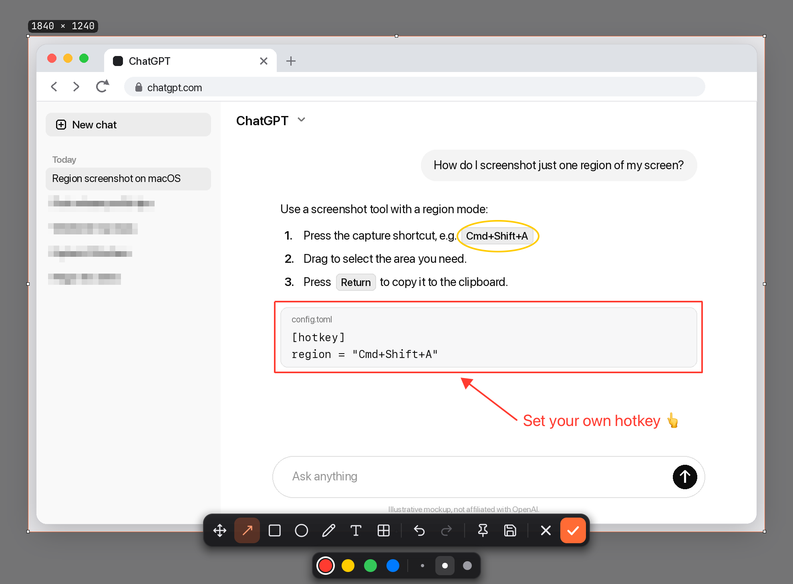
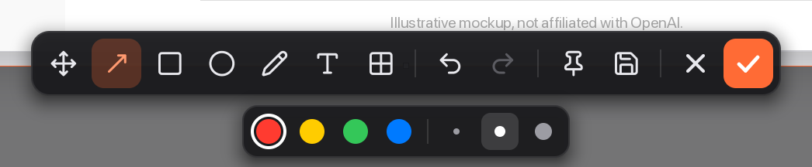
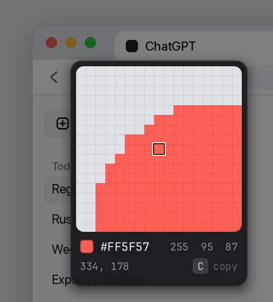

<p align="center">
  
</p>

<h1 align="center">QuickShot</h1>

<p align="center">
  A tiny, instant screenshot tool for macOS and Windows.<br>
  Press <code>⌘⇧A</code>, select, annotate, done. A native app of about 2 MB.
</p>

<p align="center">
  <b>English</b> · <a href="README.zh-CN.md">简体中文</a>
</p>

<p align="center">
  <a href="../../releases/latest"></a>
  <a href="../../actions/workflows/release.yml"></a>
  
  
  <a href="#license"></a>
</p>

---

<p align="center">
  
  <br>
  <sub>The captured page is an illustrative mockup, not affiliated with OpenAI.</sub>
</p>

## Features

- **Instant.** The overlay appears in well under a fifth of a second, even on a 6K display. The window, fonts and capture pipeline are warmed up at launch and reused, and frames go to the screen zero-copy, so drawing keeps up with the cursor.
- **Select it your way.** Drag a region, or (on macOS) hover a window and click to snap to it. Resize from the edges and corners; a live `W × H` label shows the exact pixel size.
- **Annotate.** Arrow, rectangle, ellipse, pen, text and mosaic, in four colors and three sizes. Move any annotation afterwards; undo and redo freely.
- **Real text input.** The text tool is a native text field: IME (Chinese, Japanese…), emoji, selection, and `⌘C` / `⌘V` / `⌘X` / `⌘A` / `⌘Z` all just work. What you type is exactly what gets exported.
- **Pixel-perfect magnifier.** While choosing a region, a loupe shows the zoomed pixel grid, the color under the cursor as HEX and RGB, and its coordinates. Press `C` to copy the HEX value.
- **Finish fast.** `↩` or double-click copies to the clipboard. Or **pin** the shot as a floating always-on-top window, or **save** it as PNG.
- **Full-screen capture** with a second hotkey, straight to the clipboard.
- **Plain-text config.** One `config.toml` for hotkeys and auto-save. Changes apply within a second, with no restart.
- **Light and private.** Lives in the menu bar / system tray. No network access, no telemetry. Pure Rust, about 2 MB per architecture.

<p align="center">
  
</p>

<details>
<summary>More screenshots</summary>

<p align="center"></p>

</details>

## Install

### macOS

1. Download `QuickShot-<version>.dmg` from the [latest release](../../releases/latest).
2. Open it and drag **QuickShot** into **Applications**.
3. First launch: if macOS says the app is from an unidentified developer, right-click QuickShot → **Open** (only once). Alternatively run:
   ```bash
   xattr -dr com.apple.quarantine /Applications/QuickShot.app
   ```
4. Grant **Screen Recording** when asked (System Settings → Privacy & Security → Screen Recording), then reopen QuickShot.

Requires macOS 11 Big Sur or later, on Apple Silicon or Intel.

### Windows

1. Download `QuickShot-<version>-windows-x64.zip` from the [latest release](../../releases/latest).
2. Extract it anywhere and run `QuickShot.exe`. It lives in the system tray; no console window appears.
3. If SmartScreen shows *"Windows protected your PC"*, click **More info → Run anyway** (only once).

Requires Windows 10 or 11 (x64).

## Usage

| Action | macOS | Windows |
|---|---|---|
| Capture a region | `⌘⇧A` | `Ctrl+Shift+A` |
| Capture the full screen | `⌘⇧S` | `Ctrl+Shift+S` |

**While selecting**

| Key / gesture | Action |
|---|---|
| Drag | Select a region |
| Hover + click | Snap the selection to a window (macOS) |
| `C` | Copy the color under the cursor (HEX) |
| `Esc` | Cancel |

**After selecting**

| Key / gesture | Action |
|---|---|
| `↩`, double-click, or ✓ | Copy to clipboard |
| `Esc` or ✕ | Cancel |
| `M` `A` `R` `E` `P` `T` `B` | Move · Arrow · Rectangle · Ellipse · Pen · Text · Mosaic |
| `1` – `4` | Red · Yellow · Green · Blue |
| `[` / `]` | Smaller / larger stroke, text or mosaic block |
| `⌘Z` / `⌘⇧Z` (`Ctrl` on Windows) | Undo / redo |
| `H` | Show shortcut hints on the toolbar |

In the text tool, `↩` commits, `⇧↩` adds a new line and `Esc` discards. Click a committed text to edit it again.

The menu bar / tray menu also has **Capture Region**, **Capture Screen**, **Edit Config…**, **Start at Login** and **Quit**.

## Configuration

Settings live in a TOML file that is created with defaults on first run:

- macOS: `~/.config/QuickShot/config.toml`
- Windows: `%APPDATA%\QuickShot\config.toml`

Open it from the menu with **Edit Config…**. Edits are picked up within a second, and hotkeys and menu labels update without a restart.

```toml
[hotkey]
# Modifiers joined by "+", ending with a key.
# Modifiers: Cmd / Ctrl / Alt / Opt / Shift / Meta / Super
# Keys: A–Z, 0–9, F1–F24, Space, Enter, Tab, Backspace, Escape
region = "Cmd+Shift+A"          # Windows: "Ctrl+Shift+A"
fullscreen = "Cmd+Shift+S"      # Windows: "Ctrl+Shift+S"

[save]
# Also write every capture to disk as PNG.
enabled = false
directory = "~/Desktop"         # Windows: "~/Pictures"
# Placeholders: {date} {time} {datetime} {w} {h} {mode}
filename_template = "Screenshot_{datetime}.png"

[general]
# Show a notification after a full-screen capture.
notification_on_fullscreen = true
```

| Placeholder | Example |
|---|---|
| `{date}` | `2026-04-19` |
| `{time}` | `15-04-30` |
| `{datetime}` | `2026-04-19_15-04-30` |
| `{w}`, `{h}` | `1920`, `1080` (physical pixels) |
| `{mode}` | `region` or `fullscreen` |

> **Windows:** `Win+Shift+S` is reserved by the system Snipping Tool, so a `Super+Shift+S` binding fails to register and the previous hotkey is kept. Use `Ctrl` / `Alt` combinations instead.

## Build from source

Requires Rust stable.

```bash
git clone https://github.com/simmzl/QuickShot.git
cd QuickShot
cargo test                  # run tests
cargo build --release       # → target/release/QuickShot[.exe]
```

Packaging:

| Platform | Command | Output |
|---|---|---|
| macOS | `bash scripts/package.sh` | `dist/QuickShot.app` (universal) and `dist/QuickShot-<version>.dmg` |
| Windows | `pwsh scripts/package.ps1` (Developer PowerShell) | `dist/QuickShot-<version>-windows-x64.zip` |

`package.sh` accepts `BUNDLE_ID` (default `com.QuickShot.app`) and `SIGN_IDENTITY` (default `-`, ad-hoc). Windows builds need the MSVC toolchain (Visual Studio Build Tools with *Desktop development with C++*).

Set `QUICKSHOT_DEBUG=1` to log capture and first-frame timings, or `QUICKSHOT_FRAME_DEBUG=1` to log per-frame paint and present times.

The README screenshots are rendered from the app's real drawing code, with no screen recording:

```bash
QUICKSHOT_README_BG=path/to/background.png QUICKSHOT_README_OUT=docs/images \
  cargo test --release render_readme_images -- --ignored
```

## Releasing

Pushing a `v*` tag runs the [Release workflow](.github/workflows/release.yml). It tests and builds both platforms, then publishes a GitHub Release with the `.dmg` and `.zip`. Artifact names come from the version in `Cargo.toml`, so bump it first. See [RELEASING.md](RELEASING.md) for the step-by-step.

**Signing (optional).** Without extra setup the macOS build is ad-hoc signed. To sign it with your own certificate, add the repository secrets `MAC_CERT_P12_BASE64`, `MAC_CERT_PASSWORD` and `KEYCHAIN_PASSWORD`.

## How it works

- **Capture.** On macOS, `CGDisplayCreateImage` grabs the display under the cursor, and one multi-threaded pass converts it into both the full-brightness frame and the dimmed overlay background. Window bounds for snapping are read in parallel with `CGWindowListCopyWindowInfo`.
- **Rendering.** The overlay is drawn in software and handed to CoreAnimation through a double-buffered `IOSurface`, which is zero-copy. Shapes are rasterized per scanline over only the pixels they cover, so a full-screen arrow costs about as much as a small one.
- **Text.** Editing happens in a native `NSTextView` (Windows: an `EDIT` control). Committed text is rasterized with the same system font stack, so CJK and emoji look identical on screen and in the export.
- **Hotkeys** use `global-hotkey` and are delivered straight into the event loop without polling.

## Uninstall

**macOS**

```bash
/Applications/QuickShot.app/Contents/MacOS/QuickShot --uninstall-autostart   # if Start at Login was on
rm -rf /Applications/QuickShot.app
rm -rf ~/.config/QuickShot                                                   # optional: settings
```

**Windows:** choose **Quit** from the tray menu, then delete the folder. If Start at Login was on, also run `reg delete "HKCU\Software\Microsoft\Windows\CurrentVersion\Run" /v QuickShot /f`. Settings are in `%APPDATA%\QuickShot`.

## Contributing

Issues and pull requests are welcome. Please run `cargo test` before submitting.

## License

Licensed under either of [MIT](https://opensource.org/licenses/MIT) or [Apache-2.0](https://www.apache.org/licenses/LICENSE-2.0), at your option. © Simmzl
