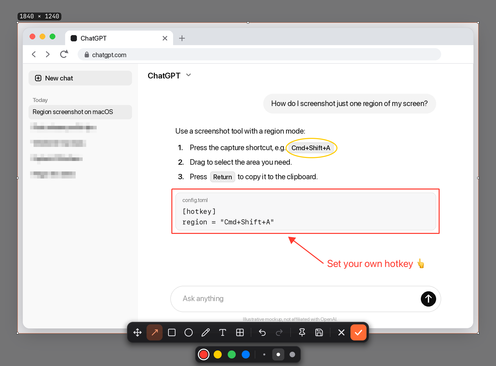
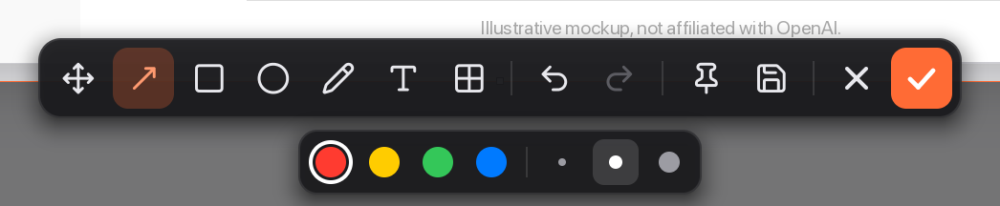
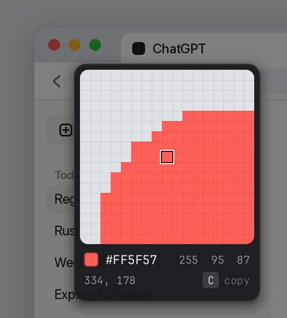

<p align="center">
  
</p>

<h1 align="center">QuickShot</h1>

<p align="center">
  小巧、秒开的截图工具，支持 macOS 和 Windows。<br>
  按 <code>⌘⇧A</code>（macOS）或 <code>Ctrl+Shift+A</code>（Windows）开始框选和标注。
</p>

<p align="center">
  <a href="README.md">English</a> · <b>简体中文</b>
</p>

<p align="center">
  <a href="../../releases/latest"></a>
  <a href="../../actions/workflows/release.yml"></a>
  
  
  <a href="#许可证"></a>
</p>

---

<p align="center">
  
  <br>
  <sub>截图中的网页为示意图，与 OpenAI 无关。</sub>
</p>

## 功能

- **秒开。** 即使在 6K 显示器上，按下快捷键后不到 0.2 秒就能出现截图界面。窗口、字体和截屏流程在启动时就已准备好并反复复用，在 macOS 上画面直接交给系统显示，不做额外拷贝，所以拖动画图很跟手。
- **想怎么选就怎么选。** 拖动可自由框选，单击可选中鼠标下高亮的窗口。Windows 也支持吸附窗口内的控件。可以拖动边和角调整大小，左上角实时显示精确的像素尺寸。
- **标注。** 箭头、矩形、椭圆、画笔、文字、马赛克，4 种颜色、3 档粗细。画好的标注可以再拖动位置，随时撤销、重做。
- **真正的输入框。** 文字工具用的是系统原生输入框，中文输入法、emoji、选中文字，以及 `⌘C` / `⌘V` / `⌘X` / `⌘A` / `⌘Z` 都和平时一样。输入什么，导出的图里就是什么。
- **像素级放大镜。** 框选时显示放大的像素网格、光标处颜色的 HEX 和 RGB 值以及坐标。按 `C` 复制 HEX 色值。
- **完成方式多样。** 按 `↩` 或双击复制到剪贴板；也可以把截图**钉在桌面**上，变成一个始终置顶的小窗口，或者**另存为** PNG。
- **全屏截图。** 一键截取鼠标所在的显示器并复制到剪贴板。默认会轻闪一下并显示通知。PNG 自动保存成功后，点击通知中的「点击查看」，即可在访达或文件资源管理器中选中这张图。
- **纯文本配置。** 快捷键、自动保存等设置都在一个 `config.toml` 里。保存后 1 秒内生效，不用重启。
- **轻量、私密。** 常驻菜单栏或系统托盘。不联网，不收集任何数据。每个架构的原生程序约 2 MB。

<p align="center">
  
</p>

<details>
<summary>更多截图</summary>

<p align="center"></p>

</details>

## 安装

### macOS

1. 在 [最新版本](../../releases/latest) 页面下载 `QuickShot-<版本号>.dmg`。
2. 打开后，把 **QuickShot** 拖进“应用程序”。
3. 首次打开：如果提示“来自身份不明的开发者”，在“应用程序”里右键点 QuickShot →「打开」，只需一次。也可以在终端运行：
   ```bash
   xattr -dr com.apple.quarantine /Applications/QuickShot.app
   ```
4. 系统请求**屏幕录制**权限时选择允许（系统设置 › 隐私与安全性 › 屏幕录制），然后重新打开 QuickShot。

需要 macOS 11 Big Sur 或更新版本，支持 Apple 芯片和 Intel 芯片。

### Windows

从[发布页](../../releases/latest)选择适合的版本。

- **安装版**（`*-Setup.exe`）。在 **Choose Install Location** 页可选择或输入安装目录。首次默认安装到 `%LOCALAPPDATA%\Programs\QuickShot`，升级会预填上次的目录。升级前先从托盘退出 QuickShot。
- **便携版**（`*-windows-x64.zip`）。解压到所选目录，运行其中的 `QuickShot.exe`。

如果 SmartScreen 提示“Windows 已保护你的电脑”，点「更多信息」→「仍要运行」，只需一次。

需要 Windows 10 或 11（x64）。

## 使用

| 操作 | macOS | Windows |
|---|---|---|
| 区域截图 | `⌘⇧A` | `Ctrl+Shift+A` |
| 全屏截图 | `⌘⇧S` | `Ctrl+Shift+S` |

**框选时**

| 按键 / 操作 | 作用 |
|---|---|
| 拖动 | 框选区域 |
| 悬停 + 点击 | 选中高亮区域，默认吸附整个窗口 |
| `Alt`（Windows） | 每次截图默认吸附整窗。按一下切换到控件吸附，再按一下切回整窗 |
| `C` | 复制光标处颜色（HEX） |
| `Esc` | 取消 |

**框选后**

| 按键 / 操作 | 作用 |
|---|---|
| `↩`、双击或点 ✓ | 复制到剪贴板 |
| `Esc` 或点 ✕ | 取消 |
| `M` `A` `R` `E` `P` `T` `B` | 移动 · 箭头 · 矩形 · 椭圆 · 画笔 · 文字 · 马赛克 |
| `1` – `4` | 红 · 黄 · 绿 · 蓝 |
| `[` / `]` | 调小 / 调大线条、文字或马赛克块 |
| `⌘Z` / `⌘⇧Z`（macOS），或点击工具栏的撤销、重做按钮（两端通用） | 撤销 / 重做 |
| `H` | 在工具栏上显示快捷键提示 |
| 拖动工具栏左侧的六点手柄 | 移动工具栏 |
| 点击图钉 | 将选区贴在桌面上。鼠标移入贴图后，点右上角的 × 关闭 |

使用文字工具时，`↩` 提交，`⇧↩` 换行，`Esc` 放弃。点一下已提交的文字可以重新编辑。

菜单栏或托盘菜单里还有：**区域截图**、**全屏截图**、**编辑配置…**、**登录时启动**、**退出**。

## 配置

设置保存在一个 TOML 文件里，首次运行时会自动生成默认配置：

- macOS：`~/.config/QuickShot/config.toml`
- Windows：`%APPDATA%\QuickShot\config.toml`

在菜单里点「编辑配置…」即可打开。保存后 1 秒内生效，快捷键和菜单文字会自动更新，不用重启。

```toml
[hotkey]
# 用 "+" 连接修饰键，最后是按键。
# 修饰键：Cmd / Ctrl / Alt / Opt / Shift / Meta / Super
# 按键：A–Z、0–9、Space、Enter、Tab、Backspace、Escape，以及功能键。
# 功能键可以单独绑定，例如 region = "F2"。macOS 支持 F1–F20，Windows 支持 F1–F11 和 F13–F24。
region = "Cmd+Shift+A"          # Windows："Ctrl+Shift+A"
fullscreen = "Cmd+Shift+S"      # Windows："Ctrl+Shift+S"

[save]
# 每次截图时，同时保存一份 PNG 到磁盘。
enabled = false
directory = "~/Desktop"         # Windows："~/Pictures"
# 占位符：{date} {time} {datetime} {w} {h} {mode}
filename_template = "QuickShot_{datetime}.png"

[general]
fullscreen_feedback = "notification"
```

**Windows 自动保存示例。** 要把截图存到 F 盘，在已有的 `[save]` 段中设置：

```toml
[save]
enabled = true
directory = "F:\images"
```

可直接粘贴资源管理器中的路径，单引号和双引号都支持。`~/Pictures` 表示当前用户目录下的 Pictures 文件夹。

**区域截图另存为。** 点击工具栏的保存按钮，会打开上次成功另存为的目录，重启后仍会记住。首次使用或上次目录已不存在时，会打开配置的 `directory`。取消对话框不会更改记录。区域和全屏截图共用 `filename_template`，默认文件名形如 `QuickShot_2026-11-13_09-30-00.png`。

**全屏截图反馈。** 无论是否自动保存，全屏截图成功时都会立即轻闪。显式设置 `fullscreen_feedback = "off"` 可以关闭轻闪。旧配置 `notification_on_fullscreen = false` 表示只轻闪，显式设置 `fullscreen_feedback` 时以新设置为准。

| `fullscreen_feedback` | 截图后的反馈 |
|---|---|
| `"notification"`（默认） | 轻闪并通知。仅复制到剪贴板或保存失败时，通知只提示已复制 |
| `"flash"` | 截取的显示器轻闪一次 |
| `"off"` | 关闭闪屏和通知 |

在 Windows 上，安装版和便携版都会在当前用户的开始菜单注册 QuickShot，以便接收通知。如果 Windows 拒绝发送通知，可以在 `%LOCALAPPDATA%\QuickShot\notification-error.log` 查看最近的错误。

全屏截图按截取顺序在后台写入。若磁盘繁忙到已有三张等待写入，新截图仍会复制到剪贴板。通知模式会提示本张未保存。

| 占位符 | 示例 |
|---|---|
| `{date}` | `2026-04-19` |
| `{time}` | `15-04-30` |
| `{datetime}` | `2026-04-19_15-04-30` |
| `{w}`、`{h}` | `1920`、`1080`（物理像素） |
| `{mode}` | `region` 或 `fullscreen` |

> **Windows 提示：** `Win+Shift+S` 已被系统自带的截图工具占用，绑定 `Super+Shift+S` 会注册失败，并保留原来的快捷键。请改用 `Ctrl` 或 `Alt` 组合。

## 从源码构建

需要 Rust stable。

```bash
git clone https://github.com/simmzl/QuickShot.git
cd QuickShot
cargo test                  # 运行测试
cargo build --release       # → target/release/QuickShot[.exe]
```

打包：

| 平台 | 命令 | 产物 |
|---|---|---|
| macOS | `bash scripts/package.sh` | `dist/QuickShot.app`（通用二进制）和 `dist/QuickShot-<版本号>.dmg` |
| Windows | `pwsh scripts/package.ps1`（在 Developer PowerShell 中运行） | `dist/QuickShot-<版本号>-windows-x64.zip` + `*-Setup.exe` |

`package.sh` 支持环境变量 `BUNDLE_ID`（默认 `com.QuickShot.app`）和 `SIGN_IDENTITY`（默认 `-`，即临时签名）。Windows 构建需要 NSIS 3 和 MSVC 工具链（安装 Visual Studio Build Tools，并勾选“使用 C++ 的桌面开发”）。

设置 `QUICKSHOT_DEBUG=1` 会打印截屏和首帧耗时，`QUICKSHOT_FRAME_DEBUG=1` 会打印每一帧的绘制和显示耗时。

README 里的截图由 App 真实的绘制代码渲染生成，不需要录屏：

```bash
QUICKSHOT_README_BG=背景图路径.png QUICKSHOT_README_OUT=docs/images \
  cargo test --release render_readme_images -- --ignored
```

## 发布

推送 `v*` 形式的标签会触发 [Release 工作流](.github/workflows/release.yml)：运行测试、构建两个平台，然后发布带 `.dmg`、`Setup.exe` 和 `.zip` 的 GitHub Release。产物文件名取自 `Cargo.toml` 里的版本号，所以要先改版本号。完整步骤见 [RELEASING.md](RELEASING.md)。

**签名（可选）。** 不做额外配置时，macOS 版本为临时签名。如需用自己的证书签名，在仓库里添加 Secrets：`MAC_CERT_P12_BASE64`、`MAC_CERT_PASSWORD` 和 `KEYCHAIN_PASSWORD`。

## 实现原理

- **截屏。** 在 macOS 上用 `CGDisplayCreateImage` 截取光标所在的屏幕，再用一次多线程转换同时生成原图和变暗的背景。用于选中窗口的窗口位置，通过 `CGWindowListCopyWindowInfo` 并行读取。
- **绘制。** macOS 的截图界面用软件绘制，通过双缓冲的 `IOSurface` 交给 CoreAnimation 显示，不做额外拷贝。图形逐行只计算实际覆盖的像素，所以画一条横跨全屏的箭头，和画一条短箭头差不多快。
- **文字。** 编辑时用原生 `NSTextView`（Windows 上是 `EDIT` 控件）。提交后的文字用同一套系统字体绘制，所以中文和 emoji 在屏幕上和导出的图里完全一致。
- **快捷键** 使用 `global-hotkey`，按下后直接送进事件循环，不轮询。

## 卸载

**macOS**

```bash
/Applications/QuickShot.app/Contents/MacOS/QuickShot --uninstall-autostart   # 如果开了“登录时启动”
rm -rf /Applications/QuickShot.app
rm -rf ~/.config/QuickShot                                                   # 可选：删除设置
```

**Windows** 安装版可在「设置 → 应用」中卸载，设置和已保存的截图会保留。便携版先关闭「登录时启动」，从托盘退出后删除解压目录。

## 参与贡献

欢迎提交 Issue 和 Pull Request。提交前请先运行 `cargo test`。

## 许可证

可任选 [MIT](https://opensource.org/licenses/MIT) 或 [Apache-2.0](https://www.apache.org/licenses/LICENSE-2.0) 许可证。© Simmzl
